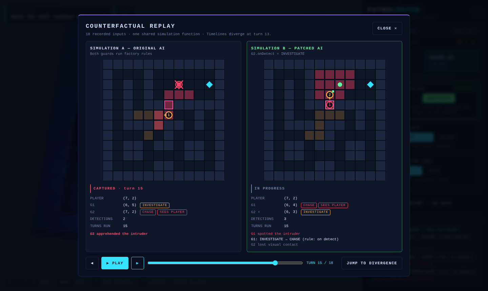

# PATROL PATCH

**A 3D stealth puzzle where you don't outrun the guards — you rewrite their AI.**

You are a hacker breaking into a research vault guarded by two security robots. Before going in, you may change
**one decision rule on one guard**. Then you sneak through the lab turn by turn, and afterwards replay your exact moves
against the *original* AI to see where the two timelines split.




Built with TypeScript, Three.js, Vite and Vitest. No backend, no runtime AI API, no game engine.

## Run it

```bash
npm install
npm run dev        # development server, http://localhost:5173
npm test           # 32 simulation tests
npm run build      # type-check + production build into dist/
npm run preview    # serve the production build
```

Node 20+ is recommended. `node scripts/single-file.mjs` (after a build) writes the whole game into one HTML file.

## How to play

| Key | Action |
| --- | --- |
| `W` `A` `S` `D` / arrows | Move one tile |
| `Space` | Wait one turn |
| `E` | Hack the terminal (when standing next to it) |
| `R` | Restart and re-open the editor |
| Mouse wheel | Zoom |

1. **Hack** — pick a guard in the *Guard AI Editor*, stage one rule change, press *Apply patch*.
2. **Infiltrate** — guards only act when you do. Coloured floor tiles show what each guard can see.
3. **Compare** — press *Compare AI behaviour* to scrub through both timelines side by side.

The level is impossible with factory AI. One of the six possible patches opens it up — and even then the patrol
guard forces you to time your approach.

## The AI system

Each guard is a finite state machine with four states:

```
            sees player                     loses sight
  PATROL ───────────────▶ CHASE ─────────────────────────▶ INVESTIGATE
     ▲                      ▲                                   │
     │ back on route        │ sees player (factory rule)        │ reached the spot
     │                      │                                   ▼
     └──────────────────── RETURN ◀─────────────────────────────┘
```

* **Detection** needs all three of: within range (euclidean), inside a 90° cone, and an unobstructed Bresenham
  line of sight (`sim/detection.ts`).
* **Navigation** is breadth-first search with a fixed neighbour order, so ties always break the same way
  (`sim/pathfinding.ts`).
* **CHASE** sprints two tiles per turn and re-targets the player after every step while they are visible.
  Every other state moves one tile per turn.
* A guard captures the player by entering their tile, in any state.

The transitions are not hard-wired. Each guard carries three rules, and the FSM reads them every turn:

| Rule (IF) | Factory (DO) | Alternative |
| --- | --- | --- |
| Player detected | `CHASE` | `INVESTIGATE` — walk to where the player was first seen; the target is never refreshed |
| Sight is lost | `INVESTIGATE` | `RETURN` — give up immediately |
| Investigation ends | `RETURN` | `SWEEP` — hold position and scan all four directions first |

## The hacking mechanic

`PatchSystem` (`sim/patch.ts`) holds a budget of exactly one `{ guardId, slot, value }` patch. When a mission
starts, `createInitialState(level, patch)` copies the factory rules into every guard and overrides the single
patched slot. From then on the patch is just data the FSM consults — there is no "if hacked then win" branch
anywhere. A patched guard still sees, still walks, and still captures you if you stand in its way (there is a
test for exactly that).

Why the intended patch works: the vault sentry sees you the moment you step through the door. Under `CHASE` it
closes two tiles per turn on your live position and you never reach the terminal. Under `INVESTIGATE` it walks
to the doorway you have already left.

## Deterministic replay

All rules live in one pure function:

```ts
step(level, state, action) → { state, events, advanced }
```

It never mutates its input and uses no randomness and no clock. Turn order is fixed: player acts → guards move
in id order (capture checked after every step) → guards perceive and switch state. Rendering reads states but
cannot influence them; animations are tweens between two states that already exist.

Because of that, a play session is fully described by its action list. *Compare AI behaviour* feeds the recorded
list through the same `step` function twice — once with no patch, once with yours — and reports the first turn
at which the two worlds differ (`sim/replay.ts`).

## The solver

`sim/solver.ts` runs an exhaustive BFS over the complete game state (player, every guard's position, facing, FSM
state, route index, targets), using the real `step` function. The test suite uses it to **prove** properties of
the level instead of trusting a hand-written route:

* no action sequence beats the level with factory AI;
* at least one patch makes it solvable, and not every patch does;
* the solver's shortest route succeeds with the patch and fails without it;
* the same route with the waiting turn removed fails — the patrol guard matters.

## Architecture

```
src/
├── sim/            pure game logic — no DOM, no Three.js, fully unit-tested
│   ├── types.ts        data model
│   ├── grid.ts         tiles, directions
│   ├── level.ts        ASCII level parser + the lab level
│   ├── pathfinding.ts  BFS
│   ├── detection.ts    range + cone + line of sight
│   ├── guard.ts        the FSM (move phase, sense phase)
│   ├── patch.ts        rule table + one-patch budget
│   ├── simulation.ts   createInitialState, step
│   ├── replay.ts       recorder + counterfactual comparison
│   └── solver.ts       exhaustive state-space search
├── render/         Three.js presentation (reads GameState only)
│   ├── scene.ts        camera, bloom, tweens, cones, labels
│   ├── environment.ts  procedural lab (instanced floor/walls, neon, props)
│   └── characters.ts   low-poly robot and hacker
├── ui/             HTML/CSS interface
│   ├── AIEditor.ts     the rule editor
│   ├── CompareView.ts  side-by-side replay
│   ├── GameUI.ts       HUD, overlays, event log
│   └── sfx.ts          WebAudio bleeps
├── tests/          Vitest suites
└── main.ts         phase machine: menu → briefing → hack → play → result → compare
```

## Design decisions

* **Simulation and rendering are separate layers.** That is what makes the solver, the replay and headless tests
  possible, and it is why animations cannot change an outcome.
* **Invalid moves consume no turn** and are not recorded, so a replay is exactly the list of turns that happened.
* **Chasing guards are faster than the player.** With equal speed a chase can never end, and the choice between
  `CHASE` and `INVESTIGATE` would not matter.
* **BFS instead of A\*.** On a 12×12 grid BFS is optimal, simpler, and its tie-breaking is easy to reason about.
* **Guards may share a tile.** Avoiding that would need a collision rule that adds state without adding puzzle depth.
* **All graphics are procedural** (primitives, instancing, emissive materials, one bloom pass). There are no
  texture or model files; the production bundle is about 140 kB gzipped.

## Technical highlights

* Deterministic, pure turn-based simulation core with 32 tests that run in under two seconds without a browser.
* Data-driven finite state machines whose transition rules can be swapped at runtime.
* Exhaustive state-space solver used as an automated level-design proof.
* Counterfactual replay: one input log, two rule sets, automatic divergence detection.
* Procedural low-poly 3D scene with instanced geometry and post-processing, driven entirely by simulation state.
* Framework-free UI in strict TypeScript; CI workflow that tests, builds and deploys to GitHub Pages.

## Deployment

`.github/workflows/ci.yml` runs the tests and build on every push and publishes `dist/` to GitHub Pages from
`main`. To enable it: push the repository to GitHub, then set *Settings → Pages → Source* to *GitHub Actions*.

## Possible next steps

* A hint button powered by the solver.
* More levels, validated automatically by the same solver tests.
* Replace primitive models with authored or generated GLB assets (the simulation would not change).
