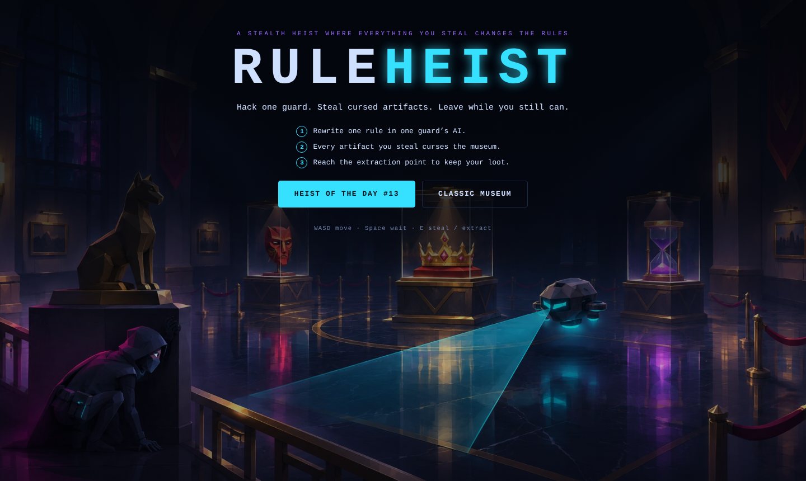
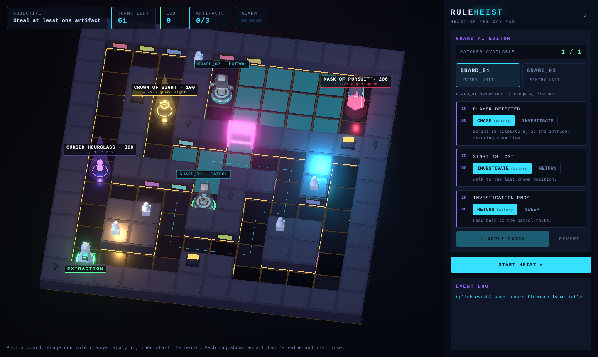

# RULE HEIST

**A stealth heist where you rewrite one rule of a guard's AI — and every artifact you steal rewrites the museum's.**

You break into a museum of cursed artifacts guarded by two security robots. Before going in you may change
**one decision rule on one guard**. Inside, each artifact you steal curses the building: guards see further,
move faster, or the clock jumps forward. Loot only counts if you carry it to the extraction point, so every run
comes down to one question: leave now, or stay for more?

Afterwards you can replay your exact moves against the *original* AI and see where the two timelines split.






Built with TypeScript, Three.js, Vite and Vitest. No backend, no runtime AI API, no game engine.
Rule Heist grew out of an earlier prototype, Patrol Patch (git tag `v1-patrol-patch`).

## Run it

```bash
npm install
npm run dev        # development server, http://localhost:5173
npm test           # 52 simulation tests (the solver proofs take ~12 s)
npm run build      # type-check + production build into dist/
npm run preview    # serve the production build
```

Node 20+ is recommended. `node scripts/single-file.mjs` (after a build) writes the whole game into one HTML file.

## How to play

| Key | Action |
| --- | --- |
| `W` `A` `S` `D` / arrows | Move one tile |
| `Space` | Wait one turn |
| `E` | Steal the artifact you stand on / open the sealed case next to you / extract |
| `R` | Restart and re-open the editor |
| Mouse wheel | Zoom |

1. **Hack** — pick a guard in the *Guard AI Editor*, stage one rule change, press *Apply patch*.
2. **Steal** — the museum is turn-based: guards only act when you do. Coloured floor tiles show what each guard
   can see; every artifact carries a tag with its value and its curse.
3. **Leave or push on** — with at least one artifact you may extract at any time. Get caught, or run out of
   turns, and the loot is lost.
4. **Compare** — press *Compare AI behaviour* to scrub through both timelines side by side.

## Artifacts and curses

| Artifact | Value | Curse |
| --- | --- | --- |
| Crown of Sight | 100 | Guards see 25% further |
| Mask of Pursuit | 200 | Guards are 20% faster — one extra step every 5th turn |
| Cursed Hourglass (sealed gallery) | 300 | The museum locks down 10 turns sooner |

A heist lasts 72 turns. The game is turn-based, so the mission timer is a turn budget rather than a wall clock,
and "20% faster" is an exact, deterministic extra step instead of a real-time speed change.

**Two rule systems, kept apart.** The player's patch rewrites one guard's *decision rule*. A curse is a row in a
data table (`sim/curses.ts`) that changes a *shared security parameter*: a range multiplier, a surge period, a
turn penalty. The FSM reads both every turn. Neither can overwrite the other — a hacked guard still gets the
longer sight range, and no curse can undo a hack (there is a test for each direction).

What the solver proves about this level:

* one artifact is easy: the crown can be out of the door in about ten turns;
* with factory AI the sealed gallery is out of reach — **300** is the most anyone can take;
* exactly **one** of the six possible patches opens the gallery;
* with that patch **all three artifacts (600)** are possible, with only seven turns left on the clock;
* a different patch has a different use: it makes the safe two-artifact run eight turns faster.

## Heist of the day

Besides the classic museum there is a daily heist: the same building re-dressed from a seed. A seed decides
which artifact is locked in the sealed gallery, where the other two stand, and which way the hall guard walks.
When the Crown is the one behind glass, the gallery is barely worth the risk and a different hack becomes the
smart choice — so the "right" patch is not the same every day.

Nothing is random at play time. `scripts/gen-daily.ts` runs the exhaustive solver over candidate seeds, keeps
only heists that are fair (something is stealable on factory AI, the right hack is worth it, all three artifacts
are possible), sets the turn limit so that the perfect run has seven turns to spare, and writes the rotation
with its proven par to `src/sim/daily-data.ts`. The result screen shows that par, your personal best (stored in
the browser) and a one-line result to copy and share.

```bash
npx vite-node scripts/gen-daily.ts 14    # regenerate a two-week rotation (about two minutes)
```

## The AI system

Each guard is a finite state machine with four states:

```
            sees player                     loses sight
  PATROL ───────────────▶ CHASE ─────────────────────────▶ INVESTIGATE
     ▲                      ▲                                   │
     │ back on route        │ sees player (factory rule)        │ reached the spot
     │                      │                                   ▼
     └──────────────────── RETURN ◀─────────────────────────────┘
```

* **Detection** needs all three of: within range (euclidean), inside a 90° cone, and an unobstructed Bresenham
  line of sight (`sim/detection.ts`).
* **Navigation** is breadth-first search with a fixed neighbour order, so ties always break the same way
  (`sim/pathfinding.ts`).
* **CHASE** sprints two tiles per turn and re-targets the player after every step while they are visible.
  Every other state moves one tile per turn.
* A guard captures the player by entering their tile, in any state. Being caught forfeits all carried loot.

The transitions are not hard-wired. Each guard carries three rules, and the FSM reads them every turn:

| Rule (IF) | Factory (DO) | Alternative |
| --- | --- | --- |
| Player detected | `CHASE` | `INVESTIGATE` — walk to where the player was first seen; the target is never refreshed |
| Sight is lost | `INVESTIGATE` | `RETURN` — give up immediately |
| Investigation ends | `RETURN` | `SWEEP` — hold position and scan all four directions first |

## The hacking mechanic

`PatchSystem` (`sim/patch.ts`) holds a budget of exactly one `{ guardId, slot, value }` patch. When a mission
starts, `createInitialState(level, patch)` copies the factory rules into every guard and overrides the single
patched slot. From then on the patch is just data the FSM consults — there is no "if hacked then win" branch
anywhere. A patched guard still sees, still walks, and still captures you if you stand in its way (there is a
test for exactly that).

Why the intended patch works: the vault sentry sees you the moment you step through the door. Under `CHASE` it
closes two tiles per turn on your live position and you never reach the terminal. Under `INVESTIGATE` it walks
to the doorway you have already left.

## Deterministic replay

All rules live in one pure function:

```ts
step(level, state, action) → { state, events, advanced }
```

It never mutates its input and uses no randomness and no clock. Turn order is fixed: player acts → guards move
in id order (capture checked after every step) → guards perceive and switch state. Rendering reads states but
cannot influence them; animations are tweens between two states that already exist.

Because of that, a play session is fully described by its action list. *Compare AI behaviour* feeds the recorded
list through the same `step` function twice — once with no patch, once with yours — and reports the first turn
at which the two worlds differ (`sim/replay.ts`).

## The solver

`sim/solver.ts` runs an exhaustive breadth-first search over the complete game state — player, stolen set, every
guard's position, facing, FSM state, route index and targets — using the real `step` function, and returns the
richest possible escape. Two things keep roughly 800,000 states tractable:

* states are deduplicated by a compact fingerprint and released as soon as they are expanded;
* **dominance pruning** on the mission clock: a state is only revisited if it has strictly more time left
  than the last time it was seen, because more time is never worse.

The test suite uses the solver to **prove** the claims above instead of trusting a hand-written route,
and checks that the stored constants shown in the UI (`LAB_PROVEN`) match what the solver finds.

## Architecture

```
src/
├── sim/            pure game logic — no DOM, no Three.js, fully unit-tested
│   ├── types.ts        data model
│   ├── grid.ts         tiles, directions
│   ├── level.ts        ASCII level parser + the lab level
│   ├── pathfinding.ts  BFS
│   ├── detection.ts    range + cone + line of sight
│   ├── guard.ts        the FSM (move phase, sense phase)
│   ├── patch.ts        rule table + one-patch budget
│   ├── curses.ts       data-driven curse table and shared security modifiers
│   ├── simulation.ts   createInitialState, step
│   ├── replay.ts       recorder + counterfactual comparison
│   ├── daily.ts        seeded variants and the heist-of-the-day rotation
│   └── solver.ts       exhaustive search for the best possible heist
├── render/         Three.js presentation (reads GameState only)
│   ├── scene.ts        camera, bloom, tweens, cones, labels
│   ├── environment.ts  procedural lab (instanced floor/walls, neon, props)
│   └── characters.ts   low-poly robot and hacker
├── ui/             HTML/CSS interface
│   ├── AIEditor.ts     the rule editor
│   ├── CompareView.ts  side-by-side replay
│   ├── GameUI.ts       HUD, overlays, event log
│   └── sfx.ts          WebAudio bleeps
├── tests/          Vitest suites
└── main.ts         phase machine: menu → briefing → hack → play → result → compare
```

## Design decisions

* **Simulation and rendering are separate layers.** That is what makes the solver, the replay and headless tests
  possible, and it is why animations cannot change an outcome.
* **A turn budget instead of a countdown in seconds.** A wall clock would make the same inputs produce different
  outcomes, which would break the replay and the solver. Turns give the same pressure and stay deterministic.
* **No randomness.** Curses are fixed per artifact and shown up front. Variety comes from the order and
  combination the player chooses.
* **Curses are data, not code.** Adding a new curse means adding a row to the table, not a branch in `step`.
* **Invalid moves consume no turn** and are not recorded, so a replay is exactly the list of turns that happened.
* **Chasing guards are faster than the player.** With equal speed a chase can never end, and the choice between
  `CHASE` and `INVESTIGATE` would not matter.
* **BFS instead of A\*.** On a 12×12 grid BFS is optimal, simpler, and its tie-breaking is easy to reason about.
* **Guards may share a tile.** Avoiding that would need a collision rule that adds state without adding puzzle depth.
* **Two generated assets, both optional.** The menu key art (`public/title.jpg`) and the guard model
  (`public/models/guard.glb`) were generated with Higgsfield (GPT Image and Tripo text-to-3D). The game probes for
  them at start-up and falls back to the procedural menu and the primitive robot if they are missing.
* **Everything else is procedural** (primitives, instancing, emissive materials, one bloom pass). There are no
  texture or model files; the production bundle is about 140 kB gzipped.

## Technical highlights

* Deterministic, pure turn-based simulation core with 52 tests that run without a browser.
* Seeded daily levels, each validated offline by the solver and shipped with a proven par score.
* Data-driven finite state machines whose transition rules can be swapped at runtime.
* Exhaustive state-space solver with dominance pruning, used as an automated level-design proof
  (optimal haul with and without a patch).
* Risk/reward layer built on a data-driven modifier table, kept architecturally separate from the AI patch.
* Counterfactual replay: one input log, two rule sets, automatic divergence detection.
* Procedural low-poly 3D scene with instanced geometry and post-processing, driven entirely by simulation state.
* Framework-free UI in strict TypeScript; CI workflow that tests, builds and deploys to GitHub Pages.

## Deployment

`.github/workflows/ci.yml` runs the tests and build on every push and publishes `dist/` to GitHub Pages from
`main`. To enable it: push the repository to GitHub, then set *Settings → Pages → Source* to *GitHub Actions*.

## Multiplayer readiness (not implemented)

Co-op for 2–4 players is a goal, not a feature. What already helps: the simulation is pure, deterministic and
independent of rendering, which is the shape a lockstep or server-authoritative model needs. What still assumes
one player: `GameState.player` is a single position, and detection, capture and the solver are written against
it. The next step would be a `players` array with ids; networking would come after that.

## Possible next steps

* A hint button powered by the solver.
* More museums, validated automatically by the same solver tests.
* Replace primitive models with authored or generated GLB assets (the simulation would not change).
