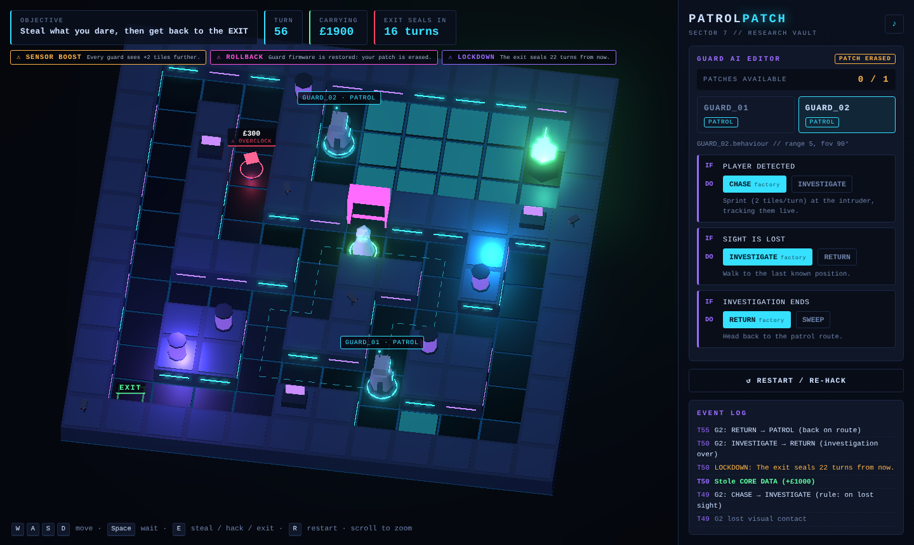

# PATROL PATCH

**A 3D stealth heist where you don't outrun the guards — you rewrite their AI.**

You are a hacker breaking into a research vault guarded by two security robots. Before going in, you may change
**one decision rule on one guard**. Inside, £2,200 of prototypes are waiting, and most of them are wired to a
countermeasure: steal one and the guards get faster, see further, lose your patch, or seal the exit. Loot only
counts if you walk it out, so every run ends with the same question: leave now, or push your luck?

Afterwards you can replay your exact moves against the *original* AI and see where the two timelines split.




Built with TypeScript, Three.js, Vite and Vitest. No backend, no runtime AI API, no game engine.

## Run it

```bash
npm install
npm run dev        # development server, http://localhost:5173
npm test           # 40 simulation tests (the solver proofs take ~15 s)
npm run build      # type-check + production build into dist/
npm run preview    # serve the production build
```

Node 20+ is recommended. `node scripts/single-file.mjs` (after a build) writes the whole game into one HTML file.

## How to play

| Key | Action |
| --- | --- |
| `W` `A` `S` `D` / arrows | Move one tile |
| `Space` | Wait one turn |
| `E` | Steal the prototype you stand on / hack the terminal next to you / leave through the exit |
| `R` | Restart and re-open the editor |
| Mouse wheel | Zoom |

1. **Hack** — pick a guard in the *Guard AI Editor*, stage one rule change, press *Apply patch*.
2. **Steal** — guards only act when you do. Coloured floor tiles show what each guard can see; every prototype
   carries a tag with its price and the countermeasure it triggers.
3. **Leave or push on** — walk back to the EXIT whenever you like. Caught or locked in, you lose everything.
4. **Compare** — press *Compare AI behaviour* to scrub through both timelines side by side.

## Loot and countermeasures

| Prototype | Value | Countermeasure when stolen |
| --- | --- | --- |
| Data shard | £100 | none |
| Cryo sample | £150 | none |
| Neural chip | £250 | **Sensor boost** — every guard sees 2 tiles further |
| Servo core | £300 | **Overclock** — every guard moves +1 tile per turn |
| Master key (in the vault) | £400 | **Rollback** — guard firmware is restored, your patch is erased |
| Core data (vault terminal) | £1,000 | **Lockdown** — the exit seals 22 turns later |

A countermeasure is not a scripted event. It is a small piece of state (`curses`, `lockdownAt`) that the same
guard FSM and the same `step` function read every turn (`sim/curses.ts`). In other words, your patch and the
facility's countermeasures are the same kind of thing: rule changes applied to a running AI — one by you, the
others against you.

What the solver proves about this level:

* with factory AI the vault is out of reach — the best possible haul is **£800**;
* exactly **one** of the six possible patches opens the vault;
* with that patch the best possible haul is **£1,900**, not £2,200: taking the servo core (Overclock) makes the
  vault run impossible, so even a perfect player has to leave something behind.

## The AI system

Each guard is a finite state machine with four states:

```
            sees player                     loses sight
  PATROL ───────────────▶ CHASE ─────────────────────────▶ INVESTIGATE
     ▲                      ▲                                   │
     │ back on route        │ sees player (factory rule)        │ reached the spot
     │                      │                                   ▼
     └──────────────────── RETURN ◀─────────────────────────────┘
```

* **Detection** needs all three of: within range (euclidean), inside a 90° cone, and an unobstructed Bresenham
  line of sight (`sim/detection.ts`).
* **Navigation** is breadth-first search with a fixed neighbour order, so ties always break the same way
  (`sim/pathfinding.ts`).
* **CHASE** sprints two tiles per turn and re-targets the player after every step while they are visible.
  Every other state moves one tile per turn.
* A guard captures the player by entering their tile, in any state. Being caught forfeits all carried loot.

The transitions are not hard-wired. Each guard carries three rules, and the FSM reads them every turn:

| Rule (IF) | Factory (DO) | Alternative |
| --- | --- | --- |
| Player detected | `CHASE` | `INVESTIGATE` — walk to where the player was first seen; the target is never refreshed |
| Sight is lost | `INVESTIGATE` | `RETURN` — give up immediately |
| Investigation ends | `RETURN` | `SWEEP` — hold position and scan all four directions first |

## The hacking mechanic

`PatchSystem` (`sim/patch.ts`) holds a budget of exactly one `{ guardId, slot, value }` patch. When a mission
starts, `createInitialState(level, patch)` copies the factory rules into every guard and overrides the single
patched slot. From then on the patch is just data the FSM consults — there is no "if hacked then win" branch
anywhere. A patched guard still sees, still walks, and still captures you if you stand in its way (there is a
test for exactly that).

Why the intended patch works: the vault sentry sees you the moment you step through the door. Under `CHASE` it
closes two tiles per turn on your live position and you never reach the terminal. Under `INVESTIGATE` it walks
to the doorway you have already left.

## Deterministic replay

All rules live in one pure function:

```ts
step(level, state, action) → { state, events, advanced }
```

It never mutates its input and uses no randomness and no clock. Turn order is fixed: player acts → guards move
in id order (capture checked after every step) → guards perceive and switch state. Rendering reads states but
cannot influence them; animations are tweens between two states that already exist.

Because of that, a play session is fully described by its action list. *Compare AI behaviour* feeds the recorded
list through the same `step` function twice — once with no patch, once with yours — and reports the first turn
at which the two worlds differ (`sim/replay.ts`).

## The solver

`sim/solver.ts` runs an exhaustive breadth-first search over the complete game state — player, stolen set, every
guard's position, facing, FSM state, route index and targets — using the real `step` function, and returns the
richest possible escape. Two things keep roughly 1.8 million states tractable:

* states are deduplicated by a compact fingerprint and released as soon as they are expanded;
* **dominance pruning** on the lockdown clock: a state is only revisited if it has strictly more time left
  than the last time it was seen, because more time is never worse.

The test suite uses the solver to **prove** the three claims above instead of trusting a hand-written route,
and checks that the stored constants shown in the UI (`LAB_PROVEN`) match what the solver finds.

## Architecture

```
src/
├── sim/            pure game logic — no DOM, no Three.js, fully unit-tested
│   ├── types.ts        data model
│   ├── grid.ts         tiles, directions
│   ├── level.ts        ASCII level parser + the lab level
│   ├── pathfinding.ts  BFS
│   ├── detection.ts    range + cone + line of sight
│   ├── guard.ts        the FSM (move phase, sense phase)
│   ├── patch.ts        rule table + one-patch budget
│   ├── curses.ts       countermeasures triggered by stealing
│   ├── simulation.ts   createInitialState, step
│   ├── replay.ts       recorder + counterfactual comparison
│   └── solver.ts       exhaustive search for the best possible heist
├── render/         Three.js presentation (reads GameState only)
│   ├── scene.ts        camera, bloom, tweens, cones, labels
│   ├── environment.ts  procedural lab (instanced floor/walls, neon, props)
│   └── characters.ts   low-poly robot and hacker
├── ui/             HTML/CSS interface
│   ├── AIEditor.ts     the rule editor
│   ├── CompareView.ts  side-by-side replay
│   ├── GameUI.ts       HUD, overlays, event log
│   └── sfx.ts          WebAudio bleeps
├── tests/          Vitest suites
└── main.ts         phase machine: menu → briefing → hack → play → result → compare
```

## Design decisions

* **Simulation and rendering are separate layers.** That is what makes the solver, the replay and headless tests
  possible, and it is why animations cannot change an outcome.
* **Stealing costs a turn, leaving does not need a key card.** The exit is always open (until a lockdown), so
  the only thing stopping you from banking your loot is the decision to go for more.
* **No randomness.** Countermeasures are fixed per prototype and shown up front. Variety comes from the order
  and combination the player chooses, and determinism is what makes the replay and the solver possible.
* **Invalid moves consume no turn** and are not recorded, so a replay is exactly the list of turns that happened.
* **Chasing guards are faster than the player.** With equal speed a chase can never end, and the choice between
  `CHASE` and `INVESTIGATE` would not matter.
* **BFS instead of A\*.** On a 12×12 grid BFS is optimal, simpler, and its tie-breaking is easy to reason about.
* **Guards may share a tile.** Avoiding that would need a collision rule that adds state without adding puzzle depth.
* **All graphics are procedural** (primitives, instancing, emissive materials, one bloom pass). There are no
  texture or model files; the production bundle is about 140 kB gzipped.

## Technical highlights

* Deterministic, pure turn-based simulation core with 40 tests that run without a browser.
* Data-driven finite state machines whose transition rules can be swapped at runtime.
* Exhaustive state-space solver with dominance pruning, used as an automated level-design proof
  (optimal haul with and without a patch).
* Risk/reward layer built from the same mechanism as the hack: runtime rule changes read by one FSM.
* Counterfactual replay: one input log, two rule sets, automatic divergence detection.
* Procedural low-poly 3D scene with instanced geometry and post-processing, driven entirely by simulation state.
* Framework-free UI in strict TypeScript; CI workflow that tests, builds and deploys to GitHub Pages.

## Deployment

`.github/workflows/ci.yml` runs the tests and build on every push and publishes `dist/` to GitHub Pages from
`main`. To enable it: push the repository to GitHub, then set *Settings → Pages → Source* to *GitHub Actions*.

## Possible next steps

* A hint button powered by the solver.
* More levels, validated automatically by the same solver tests.
* Replace primitive models with authored or generated GLB assets (the simulation would not change).
